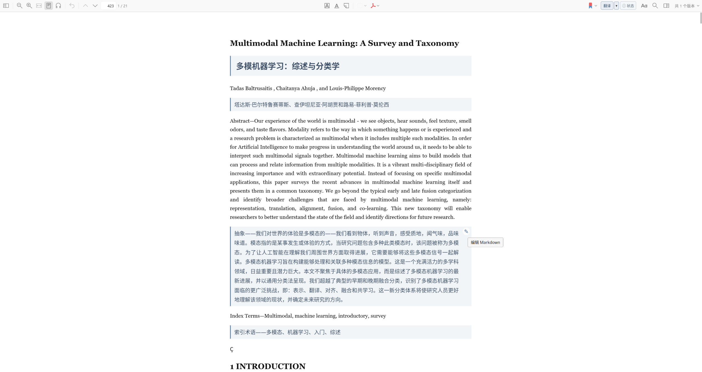

[English](README.en.md) | 简体中文

# Translate for ReadingMode

在 Zotero 10 PDF 阅读模式中逐段翻译论文，并将译文显示在对应原文下方。插件支持本地模型和多种在线翻译服务；只有用户点击翻译按钮后才会开始翻译。



## 安装与使用

在 Zotero 的“工具 → 插件”中安装项目构建的 XPI。打开 PDF 并进入阅读模式后，点击工具栏中的“翻译”按钮即可开始。普通打开 PDF 或进入阅读模式时不会自动请求翻译服务。

首次翻译会按批次处理阅读模式中的段落。每批完成后会显示译文并保存进度；全文完成后，插件会将 JSON 译文作为 Zotero 附件保存。之后再次点击按钮时，插件会核对 PDF 和段落内容，从附件恢复译文，不必重新调用模型。

工具栏菜单可隐藏译文、暂停或继续未完成的任务、保存译文以及重新翻译。工具栏中的“状态”展开栏显示当前进度或错误信息。

## 编辑译文

每个译文块都提供 Markdown 编辑入口。编辑器支持多行输入、删除和常见 Markdown 格式，例如粗体、斜体、行内代码、删除线以及上标和下标。链接地址和点击行为会从译文中移除。保存后修改会写入本地进度文件；翻译完成后，插件会更新 Zotero 中对应的 JSON 附件。原始 PDF 和阅读模式中的原文不会被修改。

## 翻译来源

在 Zotero“设置 → Translate for ReadingMode”中选择源语言、目标语言和翻译服务，并配置服务地址、模型或凭据。默认目标语言为简体中文，默认模型为 `qwen3:14b`，Ollama 地址为 `http://127.0.0.1:11434`。

支持的来源包括：

- **Ollama**：本地模型，默认使用 `qwen3:14b`。
- **Google Cloud**：Google Cloud Translation v2，需要 API Key 和服务地址。
- **Google 网页接口**：通常无需密钥；这是非官方网页接口，可能受到限流或服务变更影响。
- **DeepL**：需要 API Key。以 `:fx` 结尾的密钥会使用免费 API 地址，否则使用 Pro 地址；也可设置自定义地址。
- **Bing Translator**：Azure Translator API，需要密钥，可选配置 Azure 区域和服务地址。
- **Bing 网页接口、有道网页接口、腾讯交互翻译**：通常无需密钥，可能受到服务限流或接口变化影响。
- **彩云小译**：使用令牌；试用额度和配额由服务商决定。
- **DeepLX**：DeepL 兼容的公共或自托管服务。
- **MyMemory**：公共翻译记忆服务；匿名配额有限，可选填邮箱以提高配额。
- **LibreTranslate、MTranServer、NLLB、Pot**：本地或自托管服务，需要配置服务地址。
- **CNKI**：使用知网公开词典翻译接口，并自动刷新短期令牌；频繁请求后可能需要通过浏览器验证。
- **OpenL、百度（通用/领域）、阿里云、火山引擎、NiuTrans、通义千问、Gemini、Claude、有道大模型和 OpenAI 兼容接口**：需要凭据；部分服务按服务商规则提供免费额度。

需要云端凭据的服务可能按服务商条款收费。插件只会将当前待翻译批次发送到所选服务，并通过 Zotero 的 HTTP 客户端发出请求。

HTTP 适配器参考了 [`windingwind/zotero-pdf-translate`](https://github.com/windingwind/zotero-pdf-translate) 的公开 API 格式和接口行为。该项目使用 AGPL 许可证；本插件没有打包其源文件。

## 语言与菜单

插件界面会跟随 Zotero 语言：中文环境显示中文，其他语言环境显示英文。翻译语言包括自动检测、简体/繁体中文、英语、日语、韩语、法语、德语、西班牙语、意大利语、葡萄牙语、俄语、阿拉伯语、印地语、荷兰语、波兰语、土耳其语、越南语、泰语和印尼语。部分翻译服务支持的语言范围可能更窄。

在文献库中右键点击 PDF 附件可选择“翻译此 PDF”；右键点击文件夹可批量翻译其中的 PDF。批量任务逐篇处理、读取阅读模式结构化文本并续接已保存的进度。

## 数据保存

未完成任务保存在 Zotero 数据目录的 `readtrans/` 文件夹中，重启后可继续。全文完成后，插件会将译文保存为类似 `Translate for ReadingMode <附件 key> <目标语言>.json` 的 Zotero 附件。插件也会读取已有的 `ReadTrans …json` 附件，并且只在新附件验证通过后替换旧附件。

插件 ID、设置项、缓存路径和记录格式保持兼容，之前保存的译文仍可读取。插件不会重写 PDF 文件。

## 开发与构建

需要 Node.js 和 npm。在项目目录运行：

```bash
npm install
npm run typecheck
npm run build
```

构建会在项目根目录生成 `translate-for-readingmode-1.1.0.xpi`。在 Zotero“工具 → 插件”中选择该文件并重启 Zotero 完成安装。

当前开发环境已检查 Zotero 10.0.3 阅读模式的 `#sdt-content` 结构，并确认本机 Ollama `qwen3:14b` 接口可返回所需 JSON。实际阅读器交互仍需在 Zotero 窗口中使用测试 PDF 验收。
